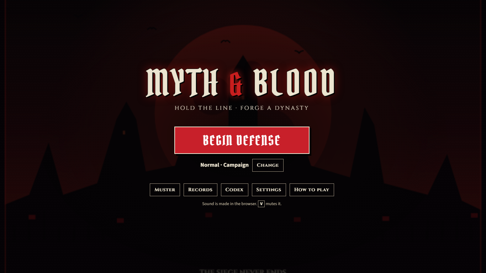
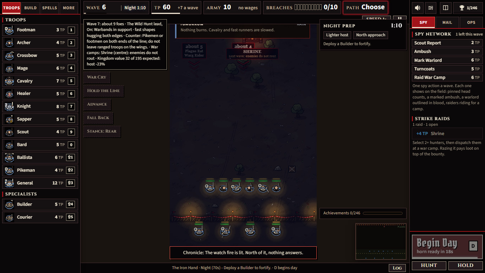

# MYTH AND BLOOD

## Field Manual of the Southern Line

_Issued to every commander who takes the field. Read it by the watch fire. Keep it dry._

---

## Contents

1. [Prologue: The Last Road North](#prologue-the-last-road-north)
2. [Getting Started](#getting-started)
3. [The Commander's Screen](#the-commanders-screen)
4. [Controls](#controls)
5. [The Shape of a Siege](#the-shape-of-a-siege)
6. [The Purse](#the-purse)
7. [Your Army](#your-army)
8. [Works and Buildings](#works-and-buildings)
9. [Doctrines, Charters and the Path](#doctrines-charters-and-the-path)
10. [Command](#command)
11. [The Host](#the-host)
12. [Spoils, Ribbons and the Muster](#spoils-ribbons-and-the-muster)
13. [Companies and Champions](#companies-and-champions)
14. [The Hundredth Dawn and Beyond](#the-hundredth-dawn-and-beyond)
15. [Modes, Difficulty and Score](#modes-difficulty-and-score)
16. [Records and Reference](#records-and-reference)
17. [Field Notes](#field-notes)
18. [Credits](#credits)

---

## Prologue: The Last Road North

The realm is a small country of fields, mills and one road north. It had a king once. It has a line of soldiers now, and whoever commands it.

North of the fields is the treeline, and past it the camps, and past them nobody has gone and come back. The host comes out of the trees at dawn. It is not one people. Goblins, orcs, the walking dead and worse, all driven the same way by the same thing. They do not parley. No one has heard them ask for anything.

Between the trees and the villages lies one field. It has been fought over every day since the first horn. The grass is gone. The mud keeps what falls in it. At the south edge of that field is a strip of trampled ground the soldiers call the line. Everything behind it is why you are here.

Ten of the enemy have names. One of them leads the host every tenth dawn. Kill one and another comes. Kill all ten and the first returns, stronger. The oldest of them is called the Eternal, and has earned it.

You have farmers' sons with shields, a few archers who count arrows the way other men count days, and a purse that refills when the sun comes up. Night is yours: mend, build and muster before the horn. Day is theirs until the last of them is dead.

Learn your soldiers' names while you can. The line remembers the ones who last.

---

## Getting Started

### Quick start

| How         | What to do                                                   |
| ----------- | ------------------------------------------------------------ |
| Browser     | Open `index.html` in a current browser. No server is needed. |
| Desktop     | `npm install`, then `npm start`.                             |
| Windows     | Double-click `Play Myth and Blood.bat`.                      |
| Install app | Run `Install Desktop App.bat`, then use the shortcut.        |

Click **Begin Defense** on the main menu. Under it you can change the difficulty and mode, and the row below opens the **Muster** (perks and handicaps for the next run), **Records**, the **Codex**, **Settings** and **How to play**. Sound starts on your first click or key press; `V` mutes it.

### Your first five minutes

1. Press `1` and click the field a few times to place Footmen in a row above the bottom edge. Press `2` and put Archers behind them.
2. Wait for the horn to be ready, then press `D` to start the day. Your soldiers fight on their own and walk back to where you put them.
3. After the wave, place a Builder, then a Wall (`L`) and a Medical Tent (`N`).
4. After wave 5, take one of the three spoils on offer, and pick a path from the PATH chip in the top bar.
5. After wave 10, open DOCTRINES on the Build tab and take one of the two on offer.

On your first runs the game introduces one system per early wave with a prompt at the bottom of the screen. It stops for good once you have reached wave 10. **Skip the introduction**, on the prompt or in the pause menu, turns it off at once.

Press `?` at any time for the keys that work on the screen in front of you.

---

## The Commander's Screen

**The top bar**, left to right:

- **WAVE** and the clock: the wave number, and how much of the night is left (or "Day" while the host is on the field).
- **TP**: what you have to spend, and what the next dawn is expected to pay.
- **ARMY**: soldiers on the field, and the wages they cost at dawn ("no wages" while you are under the free number).
- **BREACHES**: one notch for each enemy that has crossed your line, against the limit.
- **PATH**: greyed until wave 5, then the path you chose and how far along it you are.
- **SPEED** and pause.

**The left panel** has four tabs. TROOPS lists every soldier you can recruit with his price and key. BUILD holds buildings, upgrades and the DOCTRINES button. SPELLS holds spells and strikes from wave 6. MORE holds the rest: the Free Companies and other panels.

**The order bar**, just right of the left panel, holds the General's orders (War Cry, Hold the Line, Advance, Fall Back) and his stance. It is greyed while you have no General.

**The field** sits in the middle. The enemy enters at the top, your line is the red-flagged edge at the bottom. At night, markers on the top edge show where the next wave will come in, with a rough head count, and war camps stand along the top with their labels. The night preview in the top-left corner names the leading faction and what beats it. When an omen falls, its card sits at the top of the field with two answers to choose from.

**The right panel** has the sound, settings and layout buttons, your achievement count, and three tabs: SPY, MAIL (the courier) and OPS (strike raids and the rest). Below them sit the minimap, **Begin Day** with its key, and the **HUNT** and **HOLD** buttons.

**The bottom strip** shows one line of advice for the moment, and **LOG** opens the message log.

A troop, building, spell or order you cannot use is greyed out and cannot be picked. Its tooltip gives the reason.

---

## Controls

### Mouse and touch

| Input                          | Action                                                            |
| ------------------------------ | ----------------------------------------------------------------- |
| Click a troop, then the field  | Place one soldier                                                 |
| Shift+click the field          | Place one and keep the same troop in hand (also repeats walls)    |
| Click a soldier                | Select him. Drag across empty ground to select several            |
| Click the field (selected)     | Move the selection; the spot becomes their post                   |
| Shift+click (selected)         | Move there and hold                                               |
| Click an enemy (selected)      | Attack that enemy (see [The attack order](#the-attack-order))     |
| Right-click                    | Cancel what is in hand, or deselect                               |
| Middle-button drag, arrow keys | Pan                                                               |
| Mouse wheel                    | Over the field: zoom. Over a side panel: scroll that panel        |
| Touch                          | Tap places one; long-press a spot to move and hold; pinch to zoom |

`+` and `−` change the game speed, as does the SPEED button in the top bar.

### Keys

The game keeps one key map per screen. No key does two things on the same screen. Recruit keys follow the troops panel: the first ten troops take `1` to `0`, the next ones Shift with a digit, and each keeps its key for the run. Keys cannot be rebound yet.

The tables below are generated from the key maps in `js/hotkeys.js`. To regenerate them: `node scripts/gen-readme-keys.mjs --write`.

<!-- keys:start (generated by scripts/gen-readme-keys.mjs) -->

**Night: preparing** (the full field map)

| Key                 | Action                                                                           |
| ------------------- | -------------------------------------------------------------------------------- |
| ?                   | Show the keys for this screen                                                    |
| V                   | Mute / unmute sound                                                              |
| A                   | Achievements                                                                     |
| I                   | Encyclopedia                                                                     |
| `` ` ``             | Cheat codes                                                                      |
| F3                  | Performance overlay                                                              |
| F10                 | Bug report                                                                       |
| Space               | Pause                                                                            |
| Tab                 | Select the next soldier                                                          |
| Shift+Tab           | Select the previous soldier                                                      |
| Shift+M             | Message log                                                                      |
| Ctrl+A              | Select every soldier                                                             |
| Shift+G             | Centre on the General                                                            |
| Shift+B             | Centre on the last breach                                                        |
| +                   | Game speed up                                                                    |
| −                   | Game speed down                                                                  |
| F6                  | Quick save                                                                       |
| F9                  | Quick load                                                                       |
| Del                 | Demolish a building                                                              |
| \                   | Move a building                                                                  |
| H                   | Hunt: release Hold                                                               |
| Shift+H             | Hold here                                                                        |
| [                   | War Cry (General)                                                                |
| ]                   | Hold the Line (General)                                                          |
| .                   | Advance (General)                                                                |
| ,                   | Fall Back (General)                                                              |
| Z                   | Balanced loadout                                                                 |
| D                   | Begin the day (night only)                                                       |
| ↑ ↓ ← →             | Pan the map                                                                      |
| Q                   | Fireball                                                                         |
| W                   | Lightning                                                                        |
| E                   | Healing Rain                                                                     |
| R                   | Reinforcements                                                                   |
| T                   | Battle Rally                                                                     |
| F                   | Meteor Shower                                                                    |
| J                   | Frost Nova                                                                       |
| K                   | Scout Flare                                                                      |
| X                   | Fortify Zone                                                                     |
| P                   | Arcane Dispel                                                                    |
| S                   | Voice Shout                                                                      |
| ;                   | Fire Breath                                                                      |
| '                   | Ice Form                                                                         |
| 1–0 Shift+1–Shift+0 | Recruit: one key per unlocked troop, in panel order                              |
| O                   | Outpost                                                                          |
| L                   | Wall                                                                             |
| C                   | Castle                                                                           |
| N                   | Medical Tent                                                                     |
| M                   | Mess Hall                                                                        |
| G                   | Hamlet                                                                           |
| U                   | Merchant Guild                                                                   |
| Y                   | Watchtower                                                                       |
| B                   | Trade Outpost                                                                    |
| Ctrl+1–9            | Save the selection as a group (the digit then recalls it; save nothing to clear) |
| Esc                 | Pause menu                                                                       |

**Other screens**

| Screen             | Keys                                                                                                                                                                                                                                                                 | The rest                        |
| ------------------ | -------------------------------------------------------------------------------------------------------------------------------------------------------------------------------------------------------------------------------------------------------------------- | ------------------------------- |
| Main menu          | `?` Show the keys for this screen; `V` Mute / unmute sound; `A` Achievements; `I` Encyclopedia; `` ` `` Cheat codes; `F3` Performance overlay; `F10` Bug report; `Enter` Begin the defense; `Esc` Close the open panel                                               | Nothing else works              |
| Day: under attack  | Same keys as the field                                                                                                                                                                                                                                               | Off: `D`                        |
| Soldiers selected  | `Shift+A` Select every soldier of this type; `F` Centre the view on the selection; `C` Clear the selection; `B` Send them back to their posts; `G` Reform the formation (two or more); `U` Promote the selected veteran; `Alt+1–5` Formation presets; `Esc` Deselect | Everything else as on the field |
| Building picked up | `Esc` Put the building back                                                                                                                                                                                                                                          | Everything else as on the field |
| Placing or aiming  | `Esc` Cancel                                                                                                                                                                                                                                                         | Everything else as on the field |
| Placing a wall     | `R` Turn the wall before placing; `Esc` Cancel                                                                                                                                                                                                                       | Everything else as on the field |
| Paused             | `?` Show the keys for this screen; `V` Mute / unmute sound; `A` Achievements; `I` Encyclopedia; `` ` `` Cheat codes; `F3` Performance overlay; `F10` Bug report; `Space` Resume; `Esc` Resume; `Shift+M` Message log; `F6` Quick save; `F9` Quick load               | Nothing else works              |
| Spoils of war      | `1` Take the first reward; `2` Take the second reward; `3` Take the third reward; `←` Previous reward; `↑` Previous reward; `→` Next reward; `↓` Next reward; `Tab` Next reward; `Enter` Take the highlighted reward                                                 | Nothing else works              |
| After the battle   | `?` Show the keys for this screen; `V` Mute / unmute sound; `A` Achievements; `I` Encyclopedia; `` ` `` Cheat codes; `F3` Performance overlay; `F10` Bug report; `Enter` Fight again; `Esc` Close the open panel                                                     | Nothing else works              |
| Creative mode      | `P` Creative Lab panel                                                                                                                                                                                                                                               | Everything else as on the field |

<!-- keys:end -->

---

## The Shape of a Siege

### How a run goes

- **One field for the whole run.** It does not reset and does not change size. What you build stays until it is destroyed.
- **Night.** You have 75 seconds to recruit, build, choose and place. The horn is held for the first 25 seconds; after that, `D` or **Begin Day** sounds it early (see [The early horn](#the-early-horn)).
- **Day.** The wave enters from the top edge in up to three sectors (left, centre, right), forms up, and advances. Your soldiers fight from their posts. The day ends when the last enemy is dead.
- **Dawn.** Every income and every standing cost settles in one line, the dawn ledger, for example `+7 crown, +2 clean bounty, -4 wages = 5`.
- **Every 5th wave** is a horde: more enemies, arriving faster. After it you choose one of three spoils.
- **Every 10th wave** a named warlord leads the host in place of the horde, and a doctrine choice follows it.
- **The end.** The run ends when too many enemies have crossed your line, or when you have no soldiers, no Training Ground or Barracks to raise one, and not enough TP for the cheapest recruit. Clearing wave 100 opens the Victory dialog (see [The Hundredth Dawn and Beyond](#the-hundredth-dawn-and-beyond)).

### The early horn

Sounding the horn before the night runs out is a bet. It pays 1 TP for every 10 seconds of night you give up, up to 5. For each of those steps, 5% of the next host marches with this wave instead, and the next wave is that much smaller. The Early Horn edict doubles the pay; the Early Riser ribbon adds 1.

### Omens and weather

About one night in four, an omen card appears on the field. It offers two answers that change the next wave, and at most one of them costs TP. Leave it unanswered until dawn and the card takes the free answer (or tosses a coin when both are free); it tells you in advance which. Raiders, a blood moon, beasts that can be driven at the host, traps the enemy left behind, enemy scouts you can hunt or let look: all of them come as omens.

About one night in three brings weather, shown on the card:

| Weather | Effect                                                                             |
| ------- | ---------------------------------------------------------------------------------- |
| Fog     | Ranged reach halved for both sides; scouts and watchtowers lift it for your troops |
| Rain    | Nothing burns, no fire pits; cavalry and runners are slowed                        |
| Wind    | The downwind side shoots 20% further, the upwind side 20% shorter                  |
| Frost   | Everyone moves 12% slower, and laid hazards freeze over                            |

### Ground

The field is three sectors wide and three bands deep. The bottom band is home ground and always yours. The six plots above it are taken and lost.

- **Take a plot** at night by keeping three soldiers (not builders) in it for 10 seconds, next to ground you already hold. Burning a war camp hands you its plot at once, day or night.
- **Lose a plot** when enemies stand in it for 6 seconds with nobody of yours there.
- **Build** only on ground you hold. While a building is in hand, ground you cannot build on is shaded.
- **Settlements.** A held plot grows with every day it stands: Hamlet after 1 day, Village 3, Town 6, City 10, Metropolis 15. It pays its rank in TP each wave (1 for a Hamlet up to 5 for a Metropolis), one more on the front band.

A Hamlet left standing in an old save from the hand-built days still pays its old +5 TP/round. Hand-built settlements can no longer be placed.

---

## The Purse

### Tactical Points (TP)

TP pays for everything. There is no cap on what you can hold.

| Source          | Amount                                                                                  |
| --------------- | --------------------------------------------------------------------------------------- |
| Clearing a wave | The crown's pay: 7, rising slowly with the wave number; +3, 0, −1 or −2 by difficulty   |
| Clean wave      | 2 TP, plus 1 for every 10 waves, when no soldier is lost and nothing breaches           |
| Held ground     | 1 to 5 TP a wave for each settlement, one more on the front band                        |
| Trade Outpost   | +2 at dawn, if no enemy came within 160 of it that wave                                 |
| Quarry          | +3 at dawn, if no enemy came within 110 of it (six Trade Outposts and Quarries at most) |
| Early horn      | +1 for every 10 seconds of night left, up to +5                                         |
| Supply crates   | A few TP, more in later waves                                                           |
| Raids and camps | Burning a war camp pays its bounty; a strike raid adds loot on top                      |
| Spoils, ribbons | War Levy, War Chest and The Hundred                                                     |

An income site that lost its pay shows RAIDED for that dawn.

### Recruiting and army upkeep

One click places one soldier at the price on his button. Hold Shift to place several of the same troop; it stops when you release Shift, cannot pay, or press Esc. The General is one of a kind.

Your first 14 soldiers are fed for nothing. Past that, every 2 soldiers cost 1 TP in wages at each dawn, rounded up, wherever they came from. Builders and couriers are not counted. Each Granary feeds 3 more (the first three count) and each Kitchens 4 more (the first two count). If the purse cannot cover the wages, the troops go unpaid and every soldier loses 10 morale. A larger army also draws more line-breakers.

---

## Your Army

### Troops

Every troop has one role, one trait and one weakness, and every one of them can be recruited from the first wave. Select a soldier to see his card: name, rank, kills, waves survived, traits, what he is strong against and how he grows with each rank.

| Troop       | TP  | Role           | Trait                                                                                     | Weakness                                     |
| ----------- | --- | -------------- | ----------------------------------------------------------------------------------------- | -------------------------------------------- |
| Footman     | 3   | Line holder    | Shield Wall: 12% less damage for each footman or pikeman beside him, up to 36%            | Kills slowly                                 |
| Archer      | 4   | Ranged damage  | Volley: 20% more damage to targets far away                                               | 40% less damage when an enemy is in his face |
| Crossbowman | 5   | Armour piercer | Heavy Quarrel: 40% more damage to armoured enemies and siege engines                      | Reloads slowly; swarms overrun him           |
| Mage        | 6   | Area damage    | Arcane Burst: every fourth attack also hits everything near the target                    | The most fragile soldier on the field        |
| Cavalry     | 7   | Runner hunter  | Run Down: 60% more damage to line-breakers and routing enemies                            | Pikes and trolls stop a charge               |
| Healer      | 5   | Medic          | Field Dressing: soldiers near a healer slowly recover                                     | Cannot fight                                 |
| Knight      | 8   | Heavy infantry | Cleave: each swing also wounds a second enemy beside the target                           | Expensive; mages cut through the armour      |
| Sapper      | 5   | Field engineer | Demolitions: mines at night, satchel charges by day (see [The Sapper](#the-sapper))       | A knife up close; blasts cannot reach flyers |
| Scout       | 4   | Spotter        | Archers, mages and ballistae near a scout deal 12% more; he hits line-breakers 60% harder | Loses a straight fight                       |
| Bard        | 5   | Morale         | Marching Song: soldiers in earshot regain morale                                          | Weak in a fight                              |
| Ballista    | 6   | Giant killer   | Heavy Bolt: 35% more damage to bosses, monsters and elites                                | Half damage at close range; slow to move     |
| Pikeman     | 4   | Anti-cavalry   | Set Pikes: riders and beasts that strike him take 40% of the blow back                    | Arrows and magic                             |
| General     | 12  | Commander      | Orders: War Cry and Hold the Line; an aura strengthens everyone near him                  | Every enemy on the field wants him dead      |
| Builder     | 5   | Engineer       | Raises buildings, two projects at a time; soldiers near him take 10% less damage          | Barely armed                                 |
| Courier     | 4   | Messenger      | Carries one message a wave; dodges a third of arrows and bolts                            | Unarmed                                      |

The numbers come from `data/units.json` and `js/roster.js`. The Codex reads the same sources when it opens and is the reference if the two ever differ.

### Matchups

Every line beats certain enemies, and a line that beats its target deals 25% to 40% more to it. A direct hit from such a line can be a critical hit; nothing else can. The enemy has matchups too: trolls swat cavalry, dark mages cut through knights, berserkers break footmen.

| Troop                  | Strong against                  | Weak against     |
| ---------------------- | ------------------------------- | ---------------- |
| Pikeman                | Riders                          | Arrows and magic |
| Cavalry, Knight, Scout | Archers and casters             |                  |
| Archer                 | Goblins and rats                | Armour           |
| Crossbowman            | Armour and siege engines        | Swarms           |
| Mage, Ballista         | Armour                          |                  |
| Sapper                 | Armour, shields, packed enemies | Flyers           |
| Footman                | Berserkers                      |                  |

Enemy riders hit archers, mages, healers and bards harder, and pikemen take less from them. Any blow from behind lands 25% harder, for both sides.

### Posts, Hunt and Hold

Every soldier has a **post**: the spot where you placed him, or the place you last sent him. A selected soldier's post is drawn as a small bone-coloured diamond.

**Hunt is the default.** A hunting soldier leaves his post to fight what comes near it, goes for line-breakers first, helps a comrade fighting close by, and walks back when the fight is over. He is on a leash: about 240 from his post for a melee soldier, about 140 for an archer or mage, half as far again after a line-breaker. Foot soldiers do not chase shooters and casters that back away; their leash is halved against them. Cavalry and scouts keep the full leash, because riding down shooters is their job.

**Hold is an order.** A holding soldier stays where you put him and strikes only what comes inside his reach. He keeps holding through saves and trips to the med tent until you move him with a plain click or release him. A small planted shield at his feet marks him.

| Input                   | Action                                                           |
| ----------------------- | ---------------------------------------------------------------- |
| Click the field         | Move the selection; they hunt from the new post                  |
| Shift+click the field   | Move there and hold                                              |
| `Shift+H` / HOLD button | Hold here: the selection, or the whole army if nothing is picked |
| `H` / HUNT button       | Release Hold: the selection, or the whole army                   |
| `B` (with a selection)  | Back to posts now                                                |

Healers and builders follow their own work and take no Hunt or Hold order. The General keeps his own counsel.

### The attack order

With soldiers selected, click a visible enemy. Each soldier walks only as far as his own reach (archers stop at bow range), strikes that enemy before nearer ones, and keeps the spot as his post. A red ring closes on the target, and the cursor turns to a crosshair over anything the selection would attack. The order ends when the enemy falls, after 30 seconds, or when you give a plain move. Builders, couriers and healers take no attack order.

### Formations

Select two or more soldiers and the formation buttons appear (`Alt+1` to `Alt+5`; `G` reforms). A formation counts while the order stands:

| Formation | Effect                                  |
| --------- | --------------------------------------- |
| Box       | Takes 12% less damage                   |
| Line      | Shooters aim better                     |
| Wedge     | Melee deals 15% more and takes 10% more |
| Column    | Chases 30% further                      |
| Spread    | Blasts deal half damage                 |

### The med tent

Build a Medical Tent (5 TP) close behind the line.

- A wounded soldier who is **not fighting** walks to the nearest tent with a free bed, heals to full and returns to his post.
- A soldier **in a fight** stays in it while above half health and breaks off below half.
- A tent has **four beds**. The rest wait outside and still strike what comes in reach.
- Once a wave, a soldier struck down near a tent is carried in alive by the stretcher bearers. Triage carries two.
- Holding soldiers go too, and come back to hold. The General does not go.
- A red cross marks a soldier on his way; amber while he waits.

Expect gaps in the line while men heal.

### The Sapper

The Sapper is a field engineer.

- **At night** he buries 2 mines in front of his post, up to 4 live at once. A mine deals 80 damage to enemies within 46, and 25% more to line-breakers. With a Sapper selected at night, Shift+click re-sites a mine.
- **By day** he lobs a satchel charge up to 110 away every 5 seconds. It deals 46 damage within 40.
- Blasts ignore armour, shields and braced lines. They cannot reach flyers.
- A veteran Sapper buries one more mine and fuses faster.
- Up close he has only a knife. He backs away from a brawl and dies if caught alone.

### Morale

Soldiers who watch comrades die lose heart, and a soldier with none left runs. A deserter counts as a soldier lost. A Bard, a Mess Hall, the General, War Cry and Battle Rally restore morale. Every breach shakes the whole line. In waves 1 and 2 the opening garrison wavers but does not desert.

### Veterans

Every soldier gets a first and last name when he is recruited. Soldiers earn experience from kills; healers, builders and couriers earn it from their work. There are six ranks, each tougher and deadlier. From wave 10 the Veteran Doctrine charter lets you pay TP to promote one (`U`).

**Deeds and traits.** A soldier's card keeps a record of what he has done: kills by enemy type, warlords and elites slain, line-breakers cut down, kills made while holding, on a wall or below half health, waves survived at the edge of death. Ranks 1, 2, 4 and 6 each open a trait slot, and a deed fills it with a trait: one narrow gain and a named price. A soldier who has killed five trolls becomes a Trollfeller, 35% deadlier against trolls and 10% weaker against goblins. His first trait becomes his epithet. A trait can be given up for good from the card to free its slot.

**Honours.** After each warlord wave, one living veteran is honoured:

| Honour          | Effect                                                      |
| --------------- | ----------------------------------------------------------- |
| Standard Bearer | Soldiers near him do not lose heart at seeing comrades fall |
| Captain         | Soldiers of his type near him deal 10% more damage          |
| Old Hand        | New recruits of his type arrive with some experience        |

The honour shows in his name and dies with him.

**The Hall of Veterans.** A soldier who reaches rank 6 has his name written on the roll. Once a name is there, a Builder can raise the Hall of Veterans (60 TP). It raises one fallen name a wave, for six times his price, doubling with each death. He returns at rank 5 with 10% less health for each death, and keeps his deeds and traits.

When a veteran falls, the log says who he was.

---

## Works and Buildings

Every building needs a Builder on the field, and ground you hold. One Builder runs two projects at a time.

| Building         | TP  | Job                                                                                   | Opens              |
| ---------------- | --- | ------------------------------------------------------------------------------------- | ------------------ |
| Outpost          | 4   | Cover for one soldier; an archer inside shoots further                                |                    |
| Wall             | 5   | Blocks movement; holds up to 3 line-breakers a wave and makes them fight              |                    |
| Watchtower       | 4   | The night preview lists the next wave by type and number; foes in sight lose accuracy |                    |
| Spike Trap       | 3   | 45 damage to the first enemy crossing, every 1.5 seconds                              | Wave 3             |
| Medical Tent     | 5   | Heals the wounded (see [The med tent](#the-med-tent))                                 |                    |
| Mess Hall        | 5   | Soldiers near it keep their morale                                                    |                    |
| Research Lab     | 18  | Each doctrine choice comes 5 waves sooner while it stands                             |                    |
| Trade Outpost    | 10  | +2 TP at dawn after a wave in which no enemy came near                                |                    |
| Quarry           | 14  | +3 TP at dawn after a wave in which no enemy came near                                |                    |
| Castle           | 46  | A full compound: walls, outposts, a keep, a med tent and a mess hall                  | Wave 6             |
| Training Ground  | 30  | A posted mentor raises one recruit of his own type each dawn                          | Wave 10, one only  |
| Hall of Veterans | 60  | Raises fallen veterans (see [Veterans](#veterans))                                    | A name on the roll |

`DEL` demolishes a building, refunding part of its price (less if it is damaged). `\` moves a finished one. `R` turns a wall before it is placed.

### Upgrades

Most starter buildings take one upgrade, once, and the choice is final for that building. A Builder must be near.

| Building     | Either                                                     | Or                                                            |
| ------------ | ---------------------------------------------------------- | ------------------------------------------------------------- |
| Outpost      | Barracks (6): a free Footman every third dawn (two count)  | Granary (6): feeds 3 more soldiers before wages (three count) |
| Wall         | Rampart (6): soldiers behind it take far less, +150 health | Snare Line (6): holds 6 line-breakers a wave                  |
| Medical Tent | Surgery (7): heals 2.5 times as fast                       | Triage (7): carries in 2 struck-down soldiers a wave          |
| Mess Hall    | Tavern (6): morale aura twice as strong                    | Kitchens (6): feeds 4 more soldiers before wages              |
| Watchtower   | Beacon (5): sees 330 instead of 200                        | Spotter's Perch (5): foes in sight lose twice the accuracy    |
| Spike Trap   | Barbed Pit (4): 110 damage, slower reset                   | Hair Trigger (4): same 45 damage, resets far faster           |

### The Training Ground

From wave 10 you may raise one Training Ground. Select one soldier of rank 2 or higher and move him onto it. He walks to its front edge and holds there, off the line. Each dawn that he is still at his post, he raises one recruit of his own type at rank 1 (rank 2 once the Academy Charter arrives at wave 20). The recruit draws wages like any other soldier. Builders, couriers, the General and heroes cannot drill. If the ground is destroyed with the mentor on it, he takes a heavy wound that can kill him; demolishing it yourself does not.

---

## Doctrines, Charters and the Path

### Doctrines

After every tenth wave you are offered two doctrines and take one. It lasts the rest of the siege, and the one you pass over is closed. Soldiers on the field change at once and later recruits arrive with it. A choice you have not made waits for you, and the DOCTRINES button reads DOCTRINE READY.

A standing Research Lab brings each choice forward by five waves, so the first comes after wave 5. Raids, sorties and omens pay study (SP): every 3 SP bring the next choice one wave sooner.

| After wave | Either                                                     | Or                                                                     |
| ---------- | ---------------------------------------------------------- | ---------------------------------------------------------------------- |
| 10         | Pike and Shot: pikemen and crossbowmen +15% damage         | Heavy Horse: cavalry and knights +15% health                           |
| 20         | Field Works: builders work 50% faster                      | Flying Column: every soldier moves 12% faster                          |
| 30         | Massed Bows: archers +18% damage                           | War Magic: mages +18% damage, mages and healers +15% health            |
| 40         | Shield Wall: footmen and pikemen +20% health               | Siege Train: sappers and ballistas +15% damage, +25% against buildings |
| 50         | Crown Levy: +15% dawn income                               | Blooded Ranks: every soldier +6% damage                                |
| 60         | Iron Discipline: every soldier +8% health                  | Sworn Companies: heroes and champions +20% health                      |
| 70         | Forced March: scouts, cavalry and couriers move 20% faster | Chirurgeons: healers and bards +30% health                             |
| 80         | Quarry Rights: a further +15% dawn income                  | Knightly Orders: knights and the General +20% damage                   |
| 90         | Arcane Colleges: mages a further +20% damage               | Legends Walk: heroes and champions +15% damage                         |
| 100        | Last Muster: every soldier +10% health, +5% damage         | Engines of War: ballistas +30% damage, builders 30% faster             |

### Charters

Buildings beyond the starters open by charter. A charter is granted when its wave arrives; there is nothing to pay. A closed building says which wave it is waiting for.

| Charter           | Wave | Opens                                             |
| ----------------- | ---- | ------------------------------------------------- |
| Field Engineering | 3    | Spike Trap, and the Outpost's Barracks or Granary |
| Fortification     | 6    | Castle                                            |
| Veteran Doctrine  | 10   | Paying TP to promote a veteran                    |
| Academy Charter   | 20   | Training Ground recruits arrive at rank 2         |

Later charters open the companies' halls and one or two things this manual leaves for you to find.

### The Path

At wave 5 the PATH chip in the top bar offers three paths. The choice lasts the run. Each path grants five steps, at waves 5, 12, 20, 30 and 40, and every step reaches soldiers already on the field as well as later recruits.

| Path    | Strengthens                                                        | Steps                                                           |
| ------- | ------------------------------------------------------------------ | --------------------------------------------------------------- |
| Martial | Footmen, pikemen, archers, knights, generals, scouts and ballistae | Drilled, Volley Drill, Shield Wall, Old Sergeants, Iron Ranks   |
| Arcane  | Mages, healers and other casters                                   | Ward Ink, Sharpened Sigils, Blood Script, Deep Wards, Last Rite |
| Mythic  | Heroes and champions                                               | Named Blood, Saga, Godsworn, Legend, Myth Made Flesh            |

Each step is plain health, damage or morale. The chip's tooltip lists exactly what you have and what comes next.

---

## Command

### The General's orders

The General costs 12 TP and is one of a kind. Every enemy on the field goes for him. Move him like any soldier; his reach is drawn around him as a dashed ring. His orders sit in the order bar:

| Order         | Key | Effect on soldiers in his reach                    | Ready again (from the rear) |
| ------------- | --- | -------------------------------------------------- | --------------------------- |
| War Cry       | `[` | Strike 20% harder for 8 seconds, and regain morale | 45 s (27 s)                 |
| Hold the Line | `]` | Take 40% less damage for 7 seconds                 | 60 s (36 s)                 |
| Advance       | `.` | Step forward one rank                              | 20 s (12 s)                 |
| Fall Back     | `,` | Withdraw to the muster line, healers first         | 20 s (12 s)                 |

War Cry and Hold the Line are given by day; Advance and Fall Back at any time.

**Stance.** _Command from the rear_ (the default): orders recharge 40% faster. _Lead from the front_: his reach grows from 190 to 247 and the enemy goes for him even harder. The ring turns red.

**If he falls**, the army takes a morale shock and the bar greys out. When a veteran footman stands on the field, _Promote a veteran_ makes him the new General and the bar comes back.

He also walks to soldiers whose nerve has broken and steadies them. Stationed in a Castle keep, he fills the castle walls with footmen.

### Spells

Spells open on wave 6, on the SPELLS tab. Pick a spell, then click the field.

| Spell            | Key | TP  | Effect                                                 |
| ---------------- | --- | --- | ------------------------------------------------------ |
| Fireball Barrage | `Q` | 9   | 80 damage in a radius of 60                            |
| Lightning Strike | `W` | 6   | 55 damage in a radius of 50                            |
| Healing Rain     | `E` | 6   | Heals 35 in a radius of 150                            |
| Reinforcements   | `R` | 12  | Two Footmen and an Archer arrive                       |
| Battle Rally     | `T` | 6   | Morale for the whole army; ends routing                |
| Meteor Shower    | `F` | 14  | 110 damage in a radius of 75                           |
| Frost Nova       | `J` | 8   | 35 damage and a slow, radius 90                        |
| Scout Flare      | `K` | 4   | Reveals hidden enemies, radius 220                     |
| Fortify Zone     | `X` | 7   | Soldiers inside take 25% less damage                   |
| Arcane Dispel    | `P` | 5   | Clears burning ground, plague and blight; needs a Mage |

Three more spells belong to one of the champion companies and appear when it is sworn.

### Spy and courier

Both open on wave 8, in the right-hand panel. An action on cooldown shows the waves left in place of its price.

**Spy** (acts on the next wave; one action a wave). Each one shows on the field:

| Action             | TP                   | Effect                                                                                      | Limit              |
| ------------------ | -------------------- | ------------------------------------------------------------------------------------------- | ------------------ |
| Scout Report       | 2                    | Night only. The preview lists the next wave by type; head counts are pinned on the top edge |                    |
| Ambush on the Road | 3                    | A marked ambush; the first 30% of the next wave arrive at 60% health, tagged AMBUSHED       |                    |
| Mark the Warlord   | 6, +1 every 10 waves | The warlord or strongest elite is outlined in blood and takes 25% more damage               | once every 2 waves |
| Turncoats          | 5                    | 3 to 5 of the next wave's common soldiers change sides at your line and fight as footmen    | once every 2 waves |
| Raid the War Camp  | 6, +1 every 10 waves | Raiders ride for the weakest war camp                                                       | once every 2 waves |

**Courier** (needs a Courier on the field). He rides off the bottom edge and back in about 20 seconds; the order lands when he returns, and is lost if he falls on the road:

| Order          | TP            | Effect                                                          | Limit              |
| -------------- | ------------- | --------------------------------------------------------------- | ------------------ |
| Reinforcements | 4, plus wages | Two footmen and an archer march in at the muster line           | once every 2 waves |
| Field Surgeons | 3             | The wounded at the muster line heal half their health over 15 s | once every 2 waves |
| Fresh Arrows   | 3             | Ranged soldiers shoot 35% faster for 20 seconds                 | once every 2 waves |

### Strike raids

From wave 6, the OPS tab lists every standing war camp as a target. Select two to six hunters and dispatch them; they cross the field and tear the camp down. A camp razed this way pays loot on top of its bounty, more if it had dug in.

---

## The Host

### Sectors and the muster

The host enters from the top edge only, in three sectors: left, centre and right. At night the top edge shows which sectors the next wave will use, with a rough head count and a skull if a warlord is coming. Enemies arrive in squads and form up near the top before they advance. Your hunting soldiers wait for a squad to leave that ground, so the fight happens in the open field and your line keeps its shape.

One faction leads each wave and fights its own way. The night preview names it and says what beats it.

### Bestiary

The common enemies, and what each one is for:

| Enemy           | Job                                                               |
| --------------- | ----------------------------------------------------------------- |
| Goblin          | Swarm. Cheap bodies that gang up on one soldier                   |
| Orc             | Line infantry. Ties up your front rank while the rest get through |
| Orc Archer      | Skirmisher. Shoots your pikemen from behind the orcs              |
| Dark Knight     | Armoured rider. Walks through arrows to reach your shooters       |
| Warg Rider      | Raider. Goes round the line for mages and healers                 |
| Dark Mage       | Hexer. Weakens soldiers and cuts through armour                   |
| Troll           | Wall breaker. Heads for buildings and swats riders                |
| Goblin Sapper   | Bomber. Runs at a building and blows up                           |
| Necromancer     | Summoner. Keeps the field full until it dies                      |
| Berserker       | Shock trooper. Breaks a shield line and never runs                |
| Assassin        | General hunter. Ignores the line to reach him                     |
| Shaman          | Healer. Undoes your damage until it is killed                     |
| Siege Tower     | Siege engine. Batters walls from behind its own armour            |
| Goblin Engineer | Wrecker. Pulls your buildings down while the host fights          |
| War Chief       | Commander. Everything near him hits harder                        |

Stranger things come later: harpies, burrowers, drakes, wraiths, plague rats and worse. The Enemies tab of the Codex has every one, with its tactic and what beats it.

### Breaches and line-breakers

An enemy that crosses the bottom edge is a **breach**. Reach the limit and the run is over.

| Difficulty | Breach limit |
| ---------- | ------------ |
| Baby       | 14           |
| Normal     | 10           |
| Chad       | 8            |
| Hellbane   | 6            |

From wave 3 some enemies carry a red pennant. These **line-breakers** ignore your soldiers and run for the line. They are 30% faster than the rest and have a little less health.

- Cavalry and Scouts hit them 60% harder. Hunting soldiers go for them first.
- A Wall holds up to three a wave; a Snare Line six.
- Enemies also go for the line when nobody is left to fight them, or when a standoff drags on.
- Each breach shakes the morale of every soldier. With one breach left, the edges of the screen stay red.
- The Second Wall edict and two ribbons raise the limit.

### War camps

Camps go up along the top edge. The scouts warn you the night before the first one rises, around wave 6. A camp still standing when the next wave forms makes that wave stronger. Each night it is left standing it digs in, up to level III: more health, another guard, a stronger bonus, and from level II raiders sent at your nearest building at dawn. Strike a camp with soldiers and its garrison comes out to fight. Burn it and the bonus is gone, its plot is yours, and you collect its bounty. Soldiers sent that far north are not holding your line.

### Warlords

Every tenth wave is led by a named warlord with a pack of his own. There are ten, and they come in this order: Gorath the Breaker, Morwen the Pale, Thokk the Mountain, Grimm Ashborne, Vexis the Hollow, Iron Lord Karg, Sylvara Wyrm-Mother, the Rotfather, Dread Marshal Volk, and Malachar the Eternal. After the tenth the first returns, stronger. Each changes at half health; the Bosses tab of the Codex says how.

### Status marks

Small badges over a unit show what is acting on it: pinned, burning, hexed, under a banner, and so on. The Status marks tab of the Codex draws each one beside its meaning.

---

## Spoils, Ribbons and the Muster

### Spoils and edicts

Every fifth wave pays spoils. When that wave is cleared the field dims and three rewards appear in the middle of the screen. Nothing else can be clicked or pressed until you take one: `1`, `2`, `3`, or the arrow keys and Enter. The night clock waits.

Most rewards are **edicts**, standing rules for the rest of the run. The same edict can be taken up to three times and adds up each time. The strong ones carry a price, paid in the dawn ledger or in the breach limit.

| Edict            | Effect                                                                        |
| ---------------- | ----------------------------------------------------------------------------- |
| Sharpened Steel  | Soldiers deal 10% more damage. The smiths take 1 TP every dawn                |
| Hardened Shields | Soldiers take 8% less damage. The armourers take 1 TP every dawn              |
| War Levy         | +3 TP every dawn; the breach limit falls by 1                                 |
| Second Wall      | The breach limit rises by 2                                                   |
| Field Surgeons   | Soldiers recover an extra 15% health every nightfall                          |
| Steady Hearts    | +10 morale every nightfall; breaches shake soldiers half as much              |
| Veterans' Due    | Every kill earns one more point of experience; veterans claim 2 TP every dawn |
| Scavengers       | Crates land twice as often and are never bait                                 |
| Caltrops         | Line-breakers move 30% slower                                                 |
| Giant Killers    | +20% damage against warlords and elites                                       |
| War Chest        | 10 TP at once, plus 1 for every wave cleared                                  |
| Flanking Drill   | Blows from behind land 35% harder still                                       |
| Early Horn       | Sounding the horn early pays double. Once per siege                           |

### Supply crates

From wave 2, crates land on the field by day. Walk a soldier onto one. It holds TP, bandages for those nearby, or rations that lift morale. From wave 3 about one crate in seven is bait and goblins spring from it.

### Ribbons

Sixteen ribbons are earned across all your runs. Each one, once earned, can be slotted as a perk on the Muster, and gives its bonus only while slotted. Bonus starting TP from all sources together is capped at +6.

| Ribbon        | Earned by                                   | Bonus                              |
| ------------- | ------------------------------------------- | ---------------------------------- |
| First Blood   | Clear wave 1                                | +1 starting TP                     |
| Ten Dawns     | Clear wave 10                               | +2 starting TP                     |
| Quarter Siege | Clear wave 25                               | +3 starting TP                     |
| Half Siege    | Clear wave 50                               | +1 breach limit                    |
| The Hundred   | Clear wave 100                              | +1 TP per cleared wave             |
| Bosskiller    | Slay 5 warlords                             | +10% damage to warlords and elites |
| Unbroken Line | 10 waves in one run without a breach        | +1 breach limit                    |
| Clean Hands   | 5 waves in one run without losing a soldier | 3% less damage taken               |
| Quartermaster | Recover 25 crates                           | Crates land more often             |
| Early Riser   | Sound the horn early 20 times               | +1 TP on every early horn          |
| Old Guard     | Keep one soldier alive for 20 waves         | Kills earn +1 experience           |
| Butcher       | Kill 1,000 enemies                          | +3% damage                         |
| Reaper        | Kill 10,000 enemies                         | +3% damage                         |
| Gatekeeper    | Cut down 100 line-breakers                  | Line-breakers move 10% slower      |
| Council Seat  | Claim 10 spoils                             | +2 starting TP                     |
| Warband Oath  | Clear wave 15 in Warband mode               | 3% less damage taken               |

### The Muster

The Muster is the screen before a run, opened from the main menu. On the left are your perks: three slots, the first free, the second and third bought with Echo Shards earned from lifetime milestones. A slot takes a Crown Legacy, a ribbon or a branch of the Crown of Ages. Some legacies are trade-offs: Honor Guard brings an extra heir and costs 3 starting TP, Second Wall raises the breach limit by 2 and brings 10% more enemies, Blood Price adds 8% damage and makes your troops take 6% more.

On the right are the handicaps. Each makes the siege harder or easier and shows what it does to the score; conflicting ones are greyed with the reason. **Clear all** resets them. A queued New Game+ run also shows here, with an option to decline it.

---

## Companies and Champions

Champions are fighters from outside the realm, far stronger than line troops and priced to match. They come in companies. A company is sworn to your line by completing its trial, listed under Achievements; then a Builder raises its hall, and its fighters are recruited from the **Free Companies** on the MORE tab. Each company has a training tree that lasts the run, with an either-or choice in the middle.

From wave 10 the **Mercenary Camp** offers three fighters from any company each night at their listed price, one hire a night, with no hall needed. The offers are fixed for the night; reloading does not change them.

Each company has two named partners, and hiring partners together switches on a synergy. A hero's card says who he pairs with, and what the hire would complete.

Every champion has his own role, trait and weakness. Their names, prices and profiles live in the data files, and the Champions tab of the Codex shows them, so this manual does not list them. Two things stay secret until earned: a grand arena with its own roster, and one hero who costs 10,000 TP.

---

## The Hundredth Dawn and Beyond

Clearing wave 100 opens the Victory dialog. It is recorded once as the siege's victory: the victory achievements, the faction trials and legacy credit. Then you choose.

- **Continue** keeps the run going, marked Endless on the wave chip, the score and the chronicle. The host keeps growing with no ceiling. Every 25th wave past 100 tells you how big and strong it is next to wave 100. Esc picks Continue.
- **New Game+** ends the run as a victory and queues a harder one. Each tier adds 20% enemy health, 12% enemy damage and 8% more enemies, up to New Game+ 10, and adds 15% to the score per tier. The Hall of Veterans comes with you; without one, your three best living veterans do, with their rank, kills and honours.

Past wave 100 the ten warlords return in order, stronger each time, and the late siege brings loadouts, which give the whole army one passive bonus.

---

## Modes, Difficulty and Score

### Difficulty

| Difficulty | Start TP | TP per wave | Breach limit | Enemy health | Enemy damage | Enemy numbers | Score |
| ---------- | -------- | ----------- | ------------ | ------------ | ------------ | ------------- | ----- |
| Baby       | 10       | +3          | 14           | 72%          | 75%          | 78%           | ×0.5  |
| Normal     | 7        | 0           | 10           | 100%         | 100%         | 100%          | ×1    |
| Chad       | 5        | −1          | 8            | 130%         | 122%         | 122%          | ×1.5  |
| Hellbane   | 4        | −2          | 6            | 170%         | 148%         | 150%          | ×2    |

On the two harder settings the extra enemies are phased in over the first three waves. On Normal the first waves are forgiving: no orc archers before wave 3, and the enemies of the first three waves hit softer, so the first soldier you lose should fall somewhere around waves 4 to 6.

### Modes

Chosen on the main menu with CHANGE. Each mode button states its rule.

| Mode          | What changes                                                                                            |
| ------------- | ------------------------------------------------------------------------------------------------------- |
| Campaign      | The standard siege                                                                                      |
| Survival      | A lean endless run for the board: every wave pays 15% less TP; breaches and losses cost score           |
| Roguelike     | Each run rolls four advanced modifiers that never clash, fixed once the siege begins                    |
| Warband       | Soldiers cost double and are far tougher and harder-hitting                                             |
| Timed Blitz   | Half the night                                                                                          |
| Seed Run      | Waves, spawn points and field rolls come from a seed you can share                                      |
| Academy Era   | Start at wave 100 to 200 on the grown field, with a Training Ground and heavier assaults                |
| Horde         | Every wave is a horde, a third larger than usual                                                        |
| Co-op by Code | Two players take turns on one realm, handing off with a code from the pause menu                        |
| Duel by Code  | Both run the same seed and swap result codes; the higher run score wins                                 |
| Daily, Weekly | A fixed seed and modifiers for the day or the week                                                      |
| Ironman       | A toggle: no saving                                                                                     |
| Creative      | A sandbox: free TP, spawn tools, war camps on demand, no game over, nothing recorded. `P` opens the lab |

Nothing is sent over the internet. Co-op and duels work by share codes you pass yourself.

### Run score

The after-action report scores the run:

- +100 for every wave cleared and +5 for every kill
- −40 for every breach and −15 for every soldier lost, deserters included (never below zero)
- multiplied by the difficulty
- multiplied again by each handicap: one that adds 18% difficulty multiplies by 1.18, one that removes 12% by 0.88, and by each New Game+ tier

Your best score on each difficulty is kept on this device. Creative runs, abandoned runs and runs with a cheat are not scored.

---

## Records and Reference

### Saving

Save from the pause menu: a quick save (`F6`, `F9` to load), or one of three slots. Saves are kept in the browser's local storage on this device, along with ribbons, best scores, achievements and settings. Clearing site data deletes them. Ironman, daily and weekly runs and Creative mode do not save.

### Records

When a run ends, the game over screen names what ended it and lists every soldier who fell, veterans marked, with **Fight again**, **Change setup** and **Main menu**. The **Records** sheet on the main menu keeps the chronicle of past runs (score, cause, the fallen) and local run statistics. Nothing is uploaded. The message log (`Shift+M`, or LOG) can be filtered to alerts, supplies, events or the system, and folds repeats into one counted line.

### Cheats

The cheat menu opens from the main menu or with `` ` `` in a run. Using any code voids that run: no score, no ribbon progress, no achievements, and the after-action report says so. A code entered on the menu voids the next run. The codes are in `js/cheats.js`.

### The Codex and achievements

- **Codex** (`I`, the encyclopedia): How to play, Your army, Buildings, Research, Orders, Spoils and edicts, Ribbons and score, Enemies, Bosses, Status marks, Champions, World and lore. The search box looks across all of them. Nearly every entry is built from the game's data when the panel opens.
- **Achievements** (`A`): tracked across runs, with a tab per area.
- **Bug report** (`F10`) and a performance overlay (`F3`).

---

## Field Notes

_Written in the margins by commanders who came before you._

- Footmen beside footmen take far less. Keep the front rank shoulder to shoulder and put the archers a few paces behind, never level with it.
- Watch the pennants. A line-breaker that gets past the front rank is a breach unless a rider or a wall stops it. Two cavalry on the wings pay for themselves by wave 5.
- Do not sound the horn the moment it is ready unless you can afford the vanguard. Five TP is not worth a soldier.
- Build the med tent early and close. A wounded man walking two hundred paces is a man not fighting.
- Burn the first war camp before it digs in. A level III camp costs you every wave it stands.
- Take ground forward only when you can hold it by day. A plot you lose takes its settlement with it.
- Wages arrive at every dawn. An army of thirty with an empty purse is an army that runs.
- Read the night preview. The faction that leads tells you what to buy; the watchtower tells you how much.
- Give the General a veteran footman to stand near. If the General falls, promote that footman and the line keeps its orders.
- Post your best rank-2 soldier on the Training Ground at wave 10. Every dawn after that, the line gets a free recruit of his type.
- Pick a path you will actually recruit. Martial pays from the first footman; Mythic pays nothing until you hire heroes.
- Save before a warlord wave.

---

## Credits

**Myth and Blood** is a browser game written in plain JavaScript and drawn entirely in code, in a hand-inked horror-comic style: the game itself loads no image files. The music and set-piece cues are orchestral recordings rendered with MuseScore (see `tools/sfx/`); combat sounds are made in the browser.

- Design, direction and playtesting: GeddyLifeson
- Code, art, sound and text: written with Claude Code
- Source: [github.com/GeddyLifeson/Myth-and-Blood](https://github.com/GeddyLifeson/Myth-and-Blood)

Mods are welcome: see `mods/example-legion/` and the [README](README.md).

_The line holds. For now._
