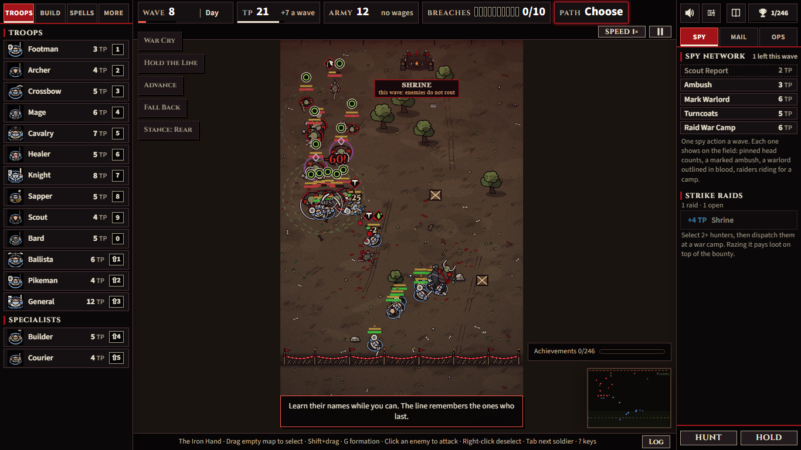

# Myth and Blood

A fantasy wave defense played on one field. The enemy comes from the top. Your line is the bottom edge. You recruit soldiers, raise works, take ground and hold for as long as you can. Soldiers who die are gone for good. Clear wave 100 and you choose: keep going, or start again harder in New Game+.

The game runs in a browser, on a laptop or a phone, and as a desktop app. Everything on screen is drawn in code in a hand-inked horror-comic style; the game loads no image files.



**[Read the Field Manual](MANUAL.md)** for the story, the screen, every key, every troop, building and enemy, and the modes.

## Quick start

| How         | What to do                                                   |
| ----------- | ------------------------------------------------------------ |
| Browser     | Open `index.html` in a current browser. No server is needed. |
| Desktop     | `npm install`, then `npm start`.                             |
| Windows     | Double-click `Play Myth and Blood.bat`.                      |
| Install app | Run `Install Desktop App.bat`, then use the shortcut.        |

Click **Begin Defense**. Press `?` in the game for the keys on the screen in front of you.

---

## Developer notes

### Building and testing

| Task                         | Command                                                                   |
| ---------------------------- | ------------------------------------------------------------------------- |
| Install                      | `npm install`                                                             |
| Play (desktop)               | `npm start`                                                               |
| Lint, types, formatting      | `npm run check`                                                           |
| All tests, with the long sim | `npm run test:all` (5 to 17 minutes)                                      |
| Tests without the long sim   | `node scripts/run-all-tests.mjs --skip-sim`                               |
| Honest playtest bot          | `npm run sim:honest`                                                      |
| Production build to `dist/`  | `npm run build`                                                           |
| Desktop installer            | `npm run dist`                                                            |
| Regenerate the key tables    | `node scripts/gen-readme-keys.mjs --write` (writes them into `MANUAL.md`) |

The build concatenates the scripts in `index.html` order and minifies them. A new `js/*.js` file needs a `<script>` tag in `index.html` at the right point, an entry in `scripts/build-manifest.mjs` (and `scripts/headless-manifest.mjs` if tests need it), and then `npm run gen:eslint-globals`. After editing `data/*.json`, run `node scripts/extract-game-data.mjs`.

### How the code is laid out

- Plain JavaScript, no framework. About 110 script files, loaded in order.
- `js/game.js` is the simulation. Run state is `GS` (`js/game-state.js`); modules reach each other through `svc('Name')`.
- `js/siege-loop.js` holds the loop described in the manual: breaches, line-breakers, spoils, crates, orders, ribbons, score.
- `js/roster.js` holds every role, trait and weakness. `js/hotkeys.js` holds every key.
- `js/encyclopedia.js` builds the reference from those at run time. `js/lore-data.js`, `js/story-lore.js` and `js/narrative-thread.js` hold the story text.
- Content is JSON in `data/`.

### Modding

`mods/manifest.json` lists the mods to load. A mod is a folder with a `mod.json`, optional `units.json` and `buildings.json`, and an optional script that receives `ModAPI`. `mods/example-legion/` is a working example that adds one troop and one building.

### Repo layout

```
index.html      the page; loads js/ in order
js/             the game
css/            style.css and the theme-v2.css HUD layer
data/           units, buildings, enemies, spells, champions, profiles (JSON)
assets/sfx/     recorded music and cues (OGG)
tools/sfx/      how the recordings were made
mods/           mod manifest and an example mod
scripts/        build, tests, simulations, generators
src/            TypeScript sources for the service, event and data cores
electron/       desktop shell
docs/           CHANGELOG.md and the overhaul audit and plan
```

### Licence

`package.json` declares MIT. There is no LICENSE file in the repo yet.
